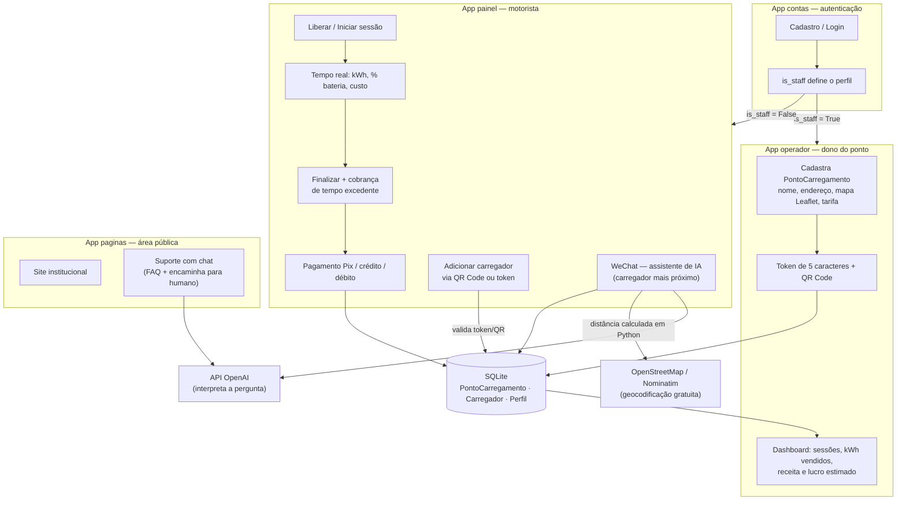
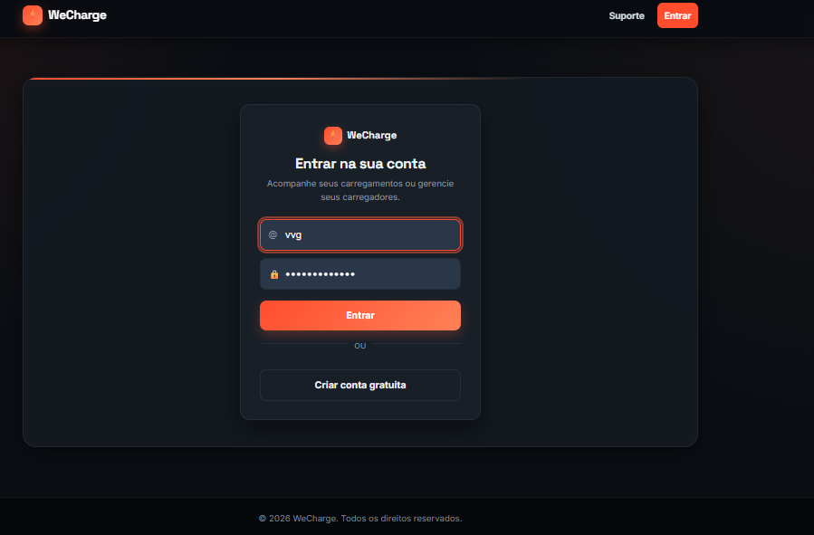
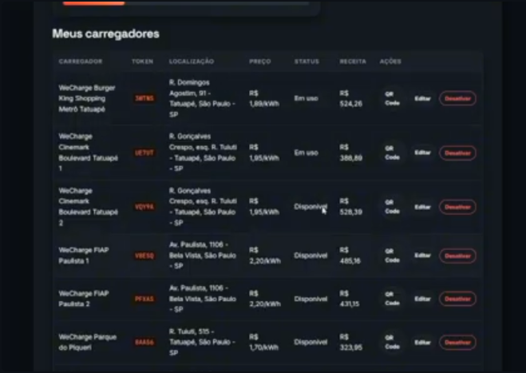
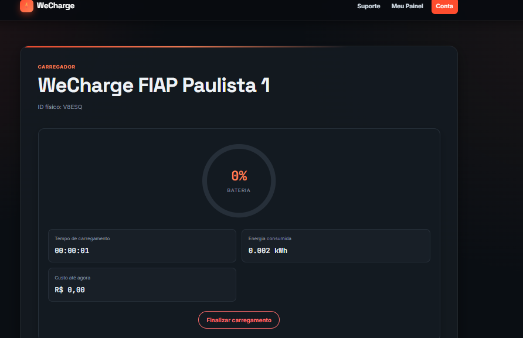
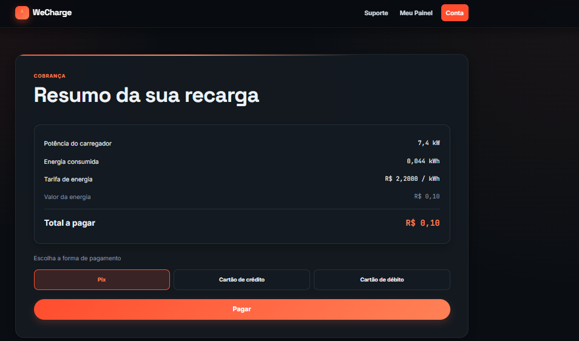
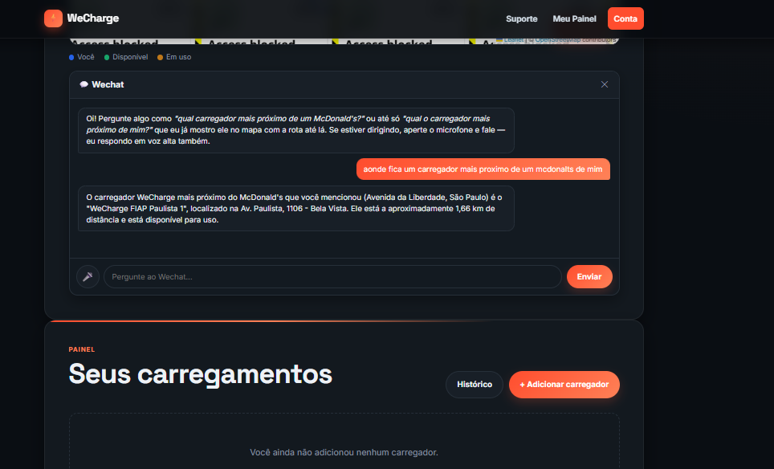

# WeCharge — Gestão Inteligente de Recarga de Veículos Elétricos

**Sprint 4 — Solução Final Integrada e Inovadora (GoodWe EV Challenge 2026 · FIAP)**
Entrega válida para: *Pensamento Computacional e Automação com Python* e *Soluções em Energias Renováveis e Sustentáveis*.

🎥 **Vídeo técnico (YouTube, não listado):** [\[LINK YOUTUBE\]](https://youtu.be/ihh1cUt9J-I)

---

## 1. Equipe

| Nome    | RM     |
|---------|--------|
| Victor  | 571483 |
| Miguel  | 568873 |
| Isabela | 569196 |
| Gustavo | 569287 |
| Artur   | 570880 |

---

## 2. O problema e a nossa proposta

A popularização dos veículos elétricos exige infraestrutura de recarga que seja **fácil de encontrar, simples de usar, transparente na cobrança e administrável por quem é dono do ponto**. Hoje, o motorista não sabe onde há um carregador livre, e o dono do ponto não tem visão de energia vendida e receita.

O **WeCharge** é uma plataforma web que conecta os dois lados:

- **Motorista:** encontra o carregador mais próximo (inclusive perguntando em linguagem natural ao assistente **WeChat**), inicia a sessão por **QR Code ou token de 5 caracteres**, acompanha kWh, % de bateria e custo em tempo real e paga por Pix/crédito/débito.
- **Operador (dono do ponto):** cadastra pontos no mapa, define a tarifa por kWh, imprime o QR Code e acompanha sessões, energia vendida e receita.

> **Transparência sobre o escopo:** o WeCharge é uma **solução de software** que **simula** o comportamento de um carregador AC (potência, bateria e tarifa parametrizadas). Não há hardware GoodWe físico conectado nesta entrega; a integração com equipamentos GoodWe está descrita na seção 5 como evolução natural da arquitetura.

---

## 3. Arquitetura final e integração dos sistemas



### Componentes

| App Django | Responsabilidade |
|---|---|
| `contas` | Cadastro, login e perfil. O campo `is_staff` separa motorista (`/painel/`) de operador (`/operador/`). |
| `operador` | CRUD de pontos de carregamento, mapa (Leaflet), geração de QR Code, dashboard financeiro e de energia. |
| `painel` | Máquina de estados da sessão de recarga, cálculo de energia/custo em tempo real, pagamento, histórico e o assistente WeChat. |
| `paginas` | Páginas públicas e chat de suporte. |
| `core` | Configurações do projeto e rotas raiz. |

### Máquina de estados da sessão

`adicionado → liberado → carregando → aguardando_pagamento → concluído`

Uma *constraint* no banco (`uma_sessao_ativa_por_ponto`) garante que **um ponto físico nunca atende duas sessões abertas ao mesmo tempo**.

---

## 4. Diferenciais inovadores

1. **Assistente de IA híbrido (WeChat).** A IA só interpreta a pergunta e formata a resposta. A busca do lugar e o **cálculo de distância são feitos de forma determinística em Python**, então o assistente não inventa carregadores, endereços nem distâncias. Primeiro procura nos pontos cadastrados e só depois recorre ao Nominatim/OpenStreetMap.
2. **Cálculo de energia parametrizado e em tempo real.** Potência (7,4 kW), capacidade de bateria (40 kWh) e tarifa ficam centralizadas no topo de `painel/models.py`, prontas para receber valores reais do equipamento.
3. **Cobrança de tempo excedente.** Depois que a bateria enche, o carro continua ocupando o ponto; o sistema passa a cobrar esse tempo, incentivando a liberação da vaga e melhorando a rotatividade do ponto.
4. **Preço congelado por sessão.** A tarifa vigente é copiada para a sessão ao iniciá-la; mudar o preço no painel do operador não afeta cobranças em andamento.
5. **Token físico + QR Code.** Simula a etiqueta do carregador real; o alfabeto evita caracteres ambíguos (0/O, 1/I).
6. **Visualização de dados e mapa.** Mapa interativo (Leaflet) para o cadastro e a busca de pontos, e dashboard do operador com dados agregados reais da conta.
7. **Suporte híbrido.** Chat com FAQ por IA, mas o pedido "quero falar com um humano" é detectado por regra determinística (regex) e encaminha para o e-mail da equipe.
8. **Segurança e isolamento.** CSRF em toda chamada que altera dados e consultas sempre filtradas por `usuario=request.user` (usuário A não acessa dados do usuário B).

---

## 5. Alinhamento com o desafio GoodWe e com as disciplinas

### Desafio GoodWe

| Requisito do desafio | Como o WeCharge atende |
|---|---|
| Gestão inteligente de recarga de VE | Fluxo completo de sessão com cálculo de energia/custo em tempo real e controle de disponibilidade por ponto. |
| Monitoramento e dados | Telemetria simulada por sessão (kWh, % bateria, tempo, custo) e dashboard agregado para o operador. |
| Experiência do usuário | Interface web responsiva, QR Code, pagamento simplificado e assistente em linguagem natural. |
| Sustentabilidade | Incentiva a eletromobilidade e o melhor uso da infraestrutura (seção 7). |
| Compatibilidade com tecnologia GoodWe | Veja abaixo. |

**Compatibilidade GoodWe (proposta de evolução, não implementada nesta entrega).** A camada de cálculo é isolada em constantes e métodos do modelo `Carregador`, de modo que a simulação possa ser substituída por **leituras reais de um carregador de VE GoodWe** (potência instantânea, energia entregue, estado da sessão) via a API/plataforma de monitoramento do fabricante. O mesmo vale para a integração com inversor fotovoltaico e bateria, permitindo priorizar a recarga nos horários de maior geração solar. Esses pontos devem ser validados contra a documentação oficial GoodWe antes de qualquer implementação.

### Pensamento Computacional e Automação com Python

- **Decomposição e abstração:** o problema foi modelado em entidades (`PontoCarregamento`, `Carregador`, `Perfil`) e em uma máquina de estados.
- **Algoritmos:** geração de token único, cálculo de energia/custo, fórmula de distância entre coordenadas e busca do carregador mais próximo.
- **Automação:** liberação condicionada à disponibilidade, cobrança automática de excedente e comando `popular_demo` que recria dados de demonstração.
- **Qualidade:** **30 testes automatizados** (`python manage.py test`), todos passando.

### Soluções em Energias Renováveis e Sustentáveis

- Gestão de energia entregue por sessão, com rastreabilidade de kWh e custo.
- Base para integrar geração solar e armazenamento, priorizando energia limpa na recarga (seção 5, evolução GoodWe).
- Estimativa de impacto ambiental (seção 7).

---

## 6. Resultados quantitativos e qualitativos

### Quantitativos — simulação com dados de demonstração

Gerados pelo comando `python manage.py popular_demo` (dados fictícios, semente fixa `2026`):

| Indicador | Resultado |
|---|---|
| Pontos de carregamento cadastrados | 17 |
| Sessões simuladas | 122 (120 concluídas + 2 em andamento) |
| Energia entregue nas sessões concluídas | **2.725,6 kWh** |
| Receita simulada | **R$ 5.345,11** |
| Testes automatizados | **30 / 30 aprovados** |

> Os números acima vêm de **dados simulados**, não de operação real.

### Qualitativos

- Fluxo ponta a ponta funcionando: cadastro → login → cadastro do ponto → QR/token → liberar → carregar → pagar → histórico.
- Dois perfis com visões distintas (motorista e operador) sobre o mesmo banco, garantindo que o preço mostrado ao operador seja o cobrado ao motorista.
- Assistente que responde com dados reais do banco, sem inventar informações.

---

## 7. Avaliação crítica: sustentabilidade e inovação

### Estimativa de CO₂ evitado (simulada)

Com os **2.725,6 kWh** da simulação, assumindo:

- eficiência do VE de ~6 km/kWh → ≈ **16.354 km** rodados;
- carro a gasolina equivalente de 10 km/L e ~2,3 kg CO₂/L → ≈ **3.761 kg CO₂** evitados;
- fator médio da rede elétrica brasileira de ~0,0385 kg CO₂/kWh → ≈ **105 kg CO₂** emitidos na geração;
- **Saldo estimado: ≈ 3,6 t de CO₂ evitadas.**

Essas premissas são **aproximadas** e servem apenas como ordem de grandeza.

### Pontos fortes

- Reduz a barreira de uso da recarga (QR Code, assistente, pagamento claro).
- Dá ao operador dados para precificar e administrar o ponto.
- Arquitetura modular e parametrizável, pronta para receber dados reais.
- IA usada onde agrega (linguagem natural) e regra determinística onde precisa de confiabilidade (distância, cobrança, encaminhamento a humano).

### Limitações (honestas)

- A telemetria é **simulada**; não há comunicação com hardware real.
- O pagamento é apenas interface (sem gateway real).
- Banco SQLite e execução local: adequado para protótipo, não para produção em escala.
- O assistente WeChat depende de chave de API externa (`OPENAI_API_KEY`) e do Nominatim.
- Ainda não há recuperação automática de senha.
- A leitura de QR Code por câmera exige HTTPS ou `localhost`.

### Próximos passos

Integração com carregadores e inversores GoodWe, priorização de recarga por geração solar, gateway de pagamento real, banco PostgreSQL e gráficos históricos no painel do operador.

---

## 8. Tecnologias, frameworks e referências

| Camada | Tecnologia |
|---|---|
| Linguagem | **Python 3** |
| Backend | **Django 5** (apps `contas`, `operador`, `painel`, `paginas`) |
| Banco de dados | SQLite |
| Frontend | HTML, CSS, JavaScript puro |
| Mapa | **Leaflet** + OpenStreetMap |
| Geocodificação | **Nominatim (OpenStreetMap)** |
| IA | **API OpenAI** (modelo configurável por `OPENAI_MODEL`) |
| QR Code | biblioteca `qrcode[pil]` |
| Configuração | `python-dotenv` (`.env`) |
| Testes | `unittest` do Django |

---

## 9. Como executar

```bash
cd wecharge_projeto
python -m venv venv
# Windows: venv\Scripts\activate   |   Mac/Linux: source venv/bin/activate
pip install -r requirements.txt
python manage.py migrate
python manage.py popular_demo      # contas e dados de demonstração
python manage.py runserver
```

Acesse `http://127.0.0.1:8000/`.

**Contas de demonstração** (senha: `Wecharge2026`): operadores `adm1`, `adm2`, `adm3`; motoristas `motorista1` a `motorista4`.

**Assistente WeChat e suporte com IA:** crie um arquivo `.env` na raiz com `OPENAI_API_KEY=sua_chave`. Sem a chave, o restante do sistema funciona normalmente.

**Testes:** `python manage.py test`

---

## 10. Estrutura do repositório

```
.
├── README.md
├── .gitignore
├── docs/img/                  # prints do sistema
└── wecharge_projeto/          # projeto Django
    ├── manage.py
    ├── requirements.txt
    ├── REGISTRO_INTEGRACAO.md # histórico da unificação Flask → Django
    ├── core/                  # settings e rotas raiz
    ├── contas/                # autenticação e perfil
    ├── operador/              # painel do dono do ponto
    ├── painel/                # fluxo do motorista, cálculo de energia, WeChat
    └── paginas/               # site público e suporte
```

---

## 11. Evidências do sistema

**Tela de login**



**Painel do operador (mapa e dashboard)**



**Carregamento em tempo real**s



**Pagamento**



**Assistente WeChat**



O diagrama de arquitetura está na seção 3 (renderizado pelo GitHub via Mermaid).
